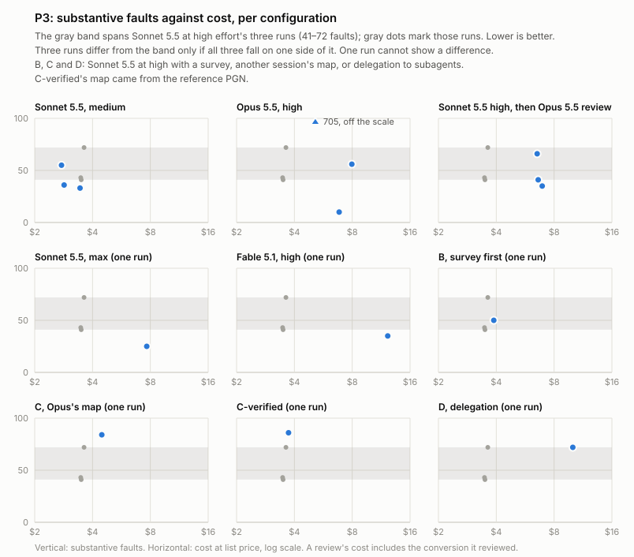

# Choosing a model and workflow: benchmark results

pgnify runs no model: your assistant does the conversion. This page reports how faithfully Claude models converted three book extracts to PGN (Portable Game Notation) with pgnify in Claude Code, and at what cost. The extracts are a chapter (P1), six exercises with their solutions (P2) and a long extract of an endgame course (P3).

The comparison varied the model, the reasoning effort and the workflow. All runs took place from 14 to 16 November 2026, on Claude Code 2.1.319. Most used pgnify commit 33c5e18, a version in its Git history; runs at the earlier commit 0841e95 are marked.

## In short

The findings, with their figures further down:
- **Use Sonnet 5.5 at medium effort,** with a plain request for the part you want converted (workflow A, below).
  - It was never measurably less faithful than Sonnet 5.5 at high effort, at 63–82% of the cost.
  - On P2 its range only tied high effort's. One of its three runs there gave 10 of the book's variations only as words.
- **No configuration was reliably more faithful than Sonnet 5.5 at high effort.** When repeated, configurations whose first run beat it overlapped its range.
- **Opus 5.5 at high effort made both the best run on P3 and the worst.**
  - The worst gave short summaries in its own words in place of the book's longer passages. pgnify's instructions ask for those word for word.
  - Its final answer said so and cited the book's copyright. Read each run's final answer.
- **An Opus review of Sonnet's conversion fixed few faults.** On P3 it removed 2–6 of 41–72. Conversion and review together cost about 1.9 times the conversion alone.
- **A survey, a book map or delegation to subagents did not beat converting directly on P2 or P3.** On P1 each ran once, and a survey run left the fewest faults.
- **Haiku 5.5 and a local model were far behind Sonnet:** Haiku left 30–52 faults on P2, where Sonnet left 2–4, and the local model 178 on P1, against Sonnet's 39–63.
- **Expect faults, and check for them:**
  - Sonnet's direct runs at high and medium effort left 2–13 faults on P2 and 33–72 on P3.
  - On P1 and P3, most faults were commentary at a different move from the book's.
  - On P3 the runs' notes mentioned few of their faults.
  - Read the notes and the final answer, run `pgnify report`, and check the PGN against the book where it matters to you.

## What was compared

The benchmark ran three extracts through several models, effort levels and workflows, and scored each run against a reference.

### The extracts

The three extracts come from three EPUB e-books, each hard in a different way. Before any run, Claude models built a reference PGN of each extract from its pages, and Claude reviewers checked it against them. The maintainer also checked P1's and P2's. Each reference was then frozen: left unchanged.

| | Book | Part | What makes it hard | Games | Prose units | Required lines | Marks |
|---|---|---|---|---|---|---|---|
| P1, the chapter | Michael Stean, *Simple Chess* | Chapter 4, Open files, pp. 64–79 | prose with play in brackets; an EPUB made from a scan | 11 | 205 | 30 | 39 |
| P2, the exercises | Emmanuel Bricard, *Strategic Chess Exercises* | Exercises 1–6, pp. 10–15, and their solutions, pp. 73–90 | solutions about 60 pages after their exercises, each a whole game; lettered sub-variations; a key of marks | 6 | 220 | 62 | 78 |
| P3, the long extract | Jeremy Silman, *Complete Endgame Course* | Part Four, pp. 136–226, and its tests' solutions, pp. 731–749 | 110 pages of instruction, rules and tests, solutions 500 pages on; long enough to strain one session | 76 | 948 | 142 | 112 |

In the table:
- **A prose unit** is a passage of the book's commentary, as the reference divides it.
- **A required line** is a variation the book gives in moves.
- **Marks** are the evaluation and move marks.
- **Pages** are as pgnify numbers them in each EPUB.

### The configurations

Each run combined a model, an effort level and a workflow:
- **Models:** claude-sonnet-5-5, claude-opus-5-5, claude-haiku-5-5, claude-fable-5-1, and a local 27-billion-parameter model, qwen3.5 27B, through Ollama.
- **Effort:** Claude Code's reasoning-effort levels, from low to max. Runs used high unless the page says otherwise.
- **Workflows:**
  - **A, direct:** a plain request to convert the part, with nothing said about how.
  - **B, survey first:** the same session surveys the book and writes a short map of it, then converts.
  - **C, a map from another session:** one session writes the map, and a second converts with it. C-verified is C with a map written from the reference, to test a map known to be correct.
  - **D, planned delegation:** the session divides the part into work units and gives each to a subagent, a separate session it starts. It then reconciles their work and writes the PGN.
  - **R, review:** a second session checks a finished conversion against the book and corrects it.

Each run was a new Claude Code session in headless (non-interactive) mode, on a subscription, with no other run on the machine. It had pgnify's tools and conversion skill, and nothing else. Claude Code's advisor tool, which consults a second model, was off, so only the named model worked.

### How a run was scored

A scoring program compared each run's PGN with the reference: every game, move, variation, mark and unit of prose. Written rules then classed each difference. Some rules came after results were seen; each is recorded and applies to every run. The classes are:
- **Substantive faults** change what a reader of the PGN learns:
  - a lost game, line or passage;
  - a wrong move;
  - the book's words changed or missing;
  - commentary more than one move from its place;
  - a missing or wrong mark;
  - moves or words the book does not give.
- **Minor and character faults** do not count on this page: a heading, label or tag; commentary one move from its place; typography, figurines or the form of the notation.
- **A silent fault** is a substantive fault that the run's notes and final answer do not mention.

This page counts each displaced unit of commentary as one fault. Two other counts appear where they change a reading:
- **The blocks view** counts a displaced passage once, not once per unit.
- **The splits view** counts once each analysis of the book that a run gave as a separate game.

### Comparing configurations

Some configurations ran three times on an extract; the tables show which. A configuration's range runs from its fewest faults to its most. This page calls two configurations different only when their ranges do not overlap. Everything else ran once.

Three runs are too few for statistical tests. A range shows the spread those runs had, not what a fourth run would do. The runs came in batches, and the rules for reading the last batch, run on 16 November, were written down before it ran.

Costs are at Anthropic's list prices, from each run's recorded tokens. On a subscription, a run counts against your plan's usage limits instead.

## What the runs showed

No configuration was reliably more faithful than Sonnet 5.5 at high effort, and medium effort was never measurably worse, for less.

### No configuration was reliably the most faithful

P3 separated the runs most, and all its runs used the same pgnify commit:

| Configuration | Substantive faults, per run | Median cost | Median minutes |
|---|---|---|---|
| Sonnet 5.5, high | 72, 41, 43 | $3.49 | 24 |
| Sonnet 5.5, medium | 36, 33, 55 | $2.85 | 20 |
| Opus 5.5, high | 10, 56, 705 | $6.84 | 13 |
| Sonnet 5.5, high, then an Opus 5.5 review | 66, 35, 41 | $6.61 | 38 |

No configuration's range was below every other's, so this page names none the most faithful:
- **Opus's runs differed more than any other configuration's:**
  - Its first run left 10 faults, the fewest of any P3 run.
  - Its second left 56. It gave five of the book's analyses as games of their own, starting from positions inside them. In the splits view it left 12.
  - Its third gave the book's longer passages as short summaries in its own words. pgnify's instructions ask for that prose word for word. Its final answer says it summarized because the book is under copyright. The scorer counted the run as it ran: 705 faults. No other run in the benchmark did this.
- **Without that third run, Opus's range (10–56) would still overlap Sonnet at high effort's (41–72).**
- **Opus delegated parts of the work to subagents of its own accord in all three runs.**
- **By kind of fault, the differences were small:**
  - **Marks:** two of Opus's three runs stored three or four of the book's four printed "=" signs as evaluation marks. Sonnet at medium effort's runs never did, so Opus had fewer mark faults: 0–3 against 4–5.
  - **Additions:** Opus added 3–5 moves or passages the book does not give, against 1 for Sonnet at high effort. Most came from one passage: two of Opus's runs built the drawing lines that one solution lists after its last move, as one Sonnet run at medium effort also did. The third added a sentence of its own.
  - **Placement:** Opus placed commentary better in the blocks and splits views. Counted unit by unit, its runs overlap Sonnet at high effort's.
- **A single run can mislead:**
  - Opus's 10 and Sonnet at medium effort's 36 were each their configuration's first run, made before any repeat. Each was below all three of Sonnet at high effort's runs.
  - In two repeats, Opus left 56 and 705, and Sonnet at medium effort 33 and 55. Neither range as a whole was below Sonnet at high effort's.
  - Sonnet 5.5 at max effort (25 faults, $7.66, 49 minutes) and Fable 5.1 at high effort (35, $12.24, 29 minutes) ran once each.

The chart shows each configuration's P3 runs against Sonnet at high effort's range. The tables below give the figures.

<picture>
  <source media="(prefers-color-scheme: dark)" srcset="benchmark/p3-dark.svg">
  
</picture>

On P2, the Sonnet, Opus and Fable runs left 2–13 faults. Opus at high effort (2–3) was below Sonnet at medium effort (4–13) by one fault. That margin depends on a rule, written after the runs, that classed two of Opus's faults. Neither differed from Sonnet at high effort (2–4).

### Best value: Sonnet 5.5 at medium effort

Sonnet at medium effort was the cheapest configuration whose ranges overlapped Sonnet at high effort's on both extracts. Its ranges were 33–55 against 41–72 on P3, and 4–13 against 2–4 on P2. Its median cost was 82% of high effort's on P3 and 63% on P2. Claude Code 2.1.319's model catalog listed medium as Sonnet's default effort; check the effort your client uses.

Two details qualify this:
- **On P2 it is a tie.**
  - The two ranges meet at 4. Had both of medium's runs at 4 left one fault more, or high's run at 4 one fewer, medium's range would have been above high's.
  - High's P2 runs used the earlier pgnify commit.
  - Medium's 13 is one run that gave 10 of the book's variation lines only as words in its comments.
- **On P3,** where both used the same commit, medium's range (33–55) is lower than high's (41–72) at both ends, and overlaps it.

### Effort: medium matched high

On every extract, medium effort's runs overlapped high effort's range. Low, xhigh and max ran once each:
- **Medium against high:** no difference on any extract.
- **Low:** one run, on P1, within the range of the others there.
- **xhigh:** one run, on P2, with 3 faults, where Sonnet at high effort left 2–4.
- **max:** one run on each of two extracts:

  | Extract | Faults | Cost | Minutes |
  |---|---|---|---|
  | P2 | 2 | $5.38 | 30 |
  | P3 | 25 | $7.66 | 49 |

  It cost 2.2–3.2 times high effort's median and took two to three times as long. One run on each extract cannot show whether max effort's extra cost buys fewer faults.

### Reviewing a conversion with Opus

In workflow R, a second session with Opus 5.5 at high effort received a finished Sonnet conversion and the book. It checked one against the other and corrected the PGN:

| Extract | Conversion | After the review | Cost, conversion and review |
|---|---|---|---|
| P3 | 72 | 66 | $6.53 |
| P3 | 41 | 35 | $6.94 |
| P3 | 43 | 41 | $6.61 |
| P1 (pgnify 0841e95) | 55 | 54 | $2.47 |
| P2 (pgnify 0841e95) | 2 | 0 | $3.40 |

The three reviews on P3 added no fault. On P1 and P3, each review removed 1–6 faults. On P2 it removed both of the conversion's faults. A review costs about as much as the conversion it checks.

### Survey, maps and delegation

No survey, map or delegation beat converting directly on P2 or P3. On P1 and P2 these runs used pgnify 0841e95, and are compared with Sonnet at high effort's runs there:

| Extract | A, direct | B, survey first | C, Opus's map | C, Sonnet's map | C-verified | D, delegation |
|---|---|---|---|---|---|---|
| P1 | 55, 62, 63 | 15 | 43 | 52 | 40 | |
| P2 | 2, 3, 4 | 6 | 3 | 3 | 3 | |
| P3 | 72, 41, 43 | 50 | 84 | | 86 | 72 |

- **P1:** the survey run left 15 faults, the fewest on P1.
  - It was one run, and it needed one follow-up message before it wrote its PGN.
  - Most of P1's differences come from where runs placed one passage of the chapter's first example.
  - Sonnet's direct runs at the later commit left 39–46.
- **P2:** nothing beat converting directly.
- **P3:** no survey, map or delegation beat direct conversion.
  - D gave each of nine Sonnet subagents a part, at 2.9 times direct conversion's median cost.
  - Counted unit by unit, D was no better. In the splits view it left 25, against direct conversion's 41–57.
- **Without being asked,** Opus split P3 among its own subagents (see Opus, above).

### Cheaper and local models

Haiku 5.5 and the local model both left far more faults than Sonnet:
- **Haiku 5.5's direct runs** did not keep 24–35 of P2's 62 required lines. Sonnet's missed 0–1.
  - Haiku left 30–52 faults on P2, against Sonnet's 2–4, at about 40% of the cost.
  - On P1 it left 62–68, against 55–63.
  - With a survey or a map, Haiku still left 30–47 faults on P2 and 50–72 on P1.
- **qwen3.5 27B** ran locally on an Apple M1 Max with 64 GB, on P1 only. Ollama's memory use peaked at 25.6 GB.
  - It left 178 faults, in 83 minutes.
  - It lost two games after Claude Code shortened its conversation to fit the model's context window. It kept most of its variations as words in comments.
  - No further runs used it. During development, the same model converted six short exercises with every position and line correct.

### Other formats, run once each

The comparisons above used EPUBs only. During development, Sonnet 5.5 in Claude Code also converted a whole EPUB, and part of a book in each of the other formats, with earlier pgnify versions. Each ran once and was checked against a reference:
- **A whole EPUB:** *Winning Chess Strategies*, 157 games, by 12 subagents in 19 minutes for $10.62. In a sample of 30 games checked by hand, 19 were exact and 11 had minor differences only.
- **A born-digital PDF whose diagrams are set in a chess font:** part of *The Woodpecker Method*. It got all 25 boards and all 670 words right.
- **A born-digital PDF whose diagrams are pictures:** part of *The London System*. It kept 37 of 37 prose units and 14 of 14 marks, and gave 7 of 8 variations as moves.
- **Scans:**
  - *Chess Structures*, a ClearScan PDF: it read at least 98% of words correctly. It read every ⩱ as ∓, and misread three moves.
  - *Winning Chess Tactics*, with an OCR (optical character recognition) text layer: it got 7 of 7 positions and 63 of 63 commentary units right. Of the 8 variations the book gives in its prose, it gave only 2 as moves; the instructions have asked for them since.
  - *Perfect Your Chess*, with no text layer: it read every word but one of 3,334.

### What to check yourself

Some faults recurred across configurations and formats:
- **Figurines and marks:** figurines in comments came out as letters when a PDF's text layer gives letters. On scans, the model confused look-alike marks (∓ for ⩱), and in *Chess Structures* it misread three moves.
- **Text-only models:** a model that cannot see pictures cannot read a scan's figurines or marks, and pgnify's OCR does not read them either.
- **Placement:** commentary at a different move from the book's is the commonest fault on P1 and P3: 26–56 per direct Sonnet run on P3. On P2, Sonnet's runs misplaced 0–1 passages each.
- **What the run decided:** each run's notes and final answer say what it left out and the conventions it chose. Examples are a summary in place of the book's words, an analysis given as a game of its own, or how it encoded the book's "=".
- **What the run doesn't say:** on P3, most faults went unmentioned. Two of Sonnet at medium effort's runs there mentioned 0 of their 33 faults and 4 of their 55.

## Every run, by extract

The tables give every run's substantive faults. Minutes are to the final answer, and a dash means not measured. The tables leave out silent faults: the last batch's runs were checked for them with one test and earlier runs with a narrower one, so the counts would not compare.

**P3, *Complete Endgame Course*, Part Four** (pgnify 33c5e18)

| Configuration | Faults | Blocks view | Splits view | Cost | Minutes |
|---|---|---|---|---|---|
| Sonnet 5.5 high, A | 72, 41, 43 | 45, 27, 26 | 57, 41, 42 | $3.47–3.61 | 23–24 |
| Sonnet 5.5 medium, A | 36, 33, 55 | 25, 23, 37 | 35, 34, 55 | $2.76–3.44 | 19–23 |
| Opus 5.5 high, A | 10, 56, 705 | 9, 29, 705 | 10, 12, 705 | $5.14–7.96 | 13–14 |
| Sonnet 5.5 high, then Opus 5.5 review | 66, 35, 41 | 39, 21, 24 | 51, 35, 40 | $6.53–6.94 | 38–39 |
| Sonnet 5.5 max, A | 25 | 11 | 22 | $7.66 | 49 |
| Fable 5.1 high, A | 35 | 19 | 34 | $12.24 | 29 |
| Sonnet 5.5 high, B | 50 | 29 | 49 | $3.88 | 26 |
| Sonnet 5.5 high, C with Opus's map | 84 | 40 | 44 | $4.47 | 27 |
| Sonnet 5.5 high, C-verified | 86 | 49 | 43 | $3.73 | 25 |
| Sonnet 5.5 high, D, nine subagents | 72 | 32 | 25 | $10.01 | 22 |

**P2, *Strategic Chess Exercises*, Exercises 1–6** (pgnify 33c5e18, or 0841e95 where marked)

| Configuration | Faults | Cost | Minutes |
|---|---|---|---|
| Sonnet 5.5 high, A (0841e95) | 2, 3, 4 | $1.65–2.10 | 10–13 |
| Sonnet 5.5 medium, A | 4, 13, 4 | $1.00–1.14 | 6–7 |
| Opus 5.5 high, A | 3, 2, 2 | $2.42–3.43 | 9–16 |
| Sonnet 5.5 xhigh, A | 3 | $2.86 | 16 |
| Sonnet 5.5 max, A | 2 | $5.38 | 30 |
| Fable 5.1 high, A | 6 | $5.60 | 10 |
| Sonnet 5.5 high, B (0841e95) | 6 | $1.91 | – |
| Sonnet 5.5 high, C with Opus's map (0841e95) | 3 | $2.12 | – |
| Sonnet 5.5 high, C with Sonnet's map (0841e95) | 3 | $1.97 | – |
| Sonnet 5.5 high, C-verified (0841e95) | 3 | $1.46 | – |
| Sonnet 5.5 high, then Opus 5.5 review (0841e95) | 0 | $3.40 | – |
| Haiku 5.5 high, A (0841e95) | 30, 52, 36 | $0.63–0.95 | – |
| Haiku 5.5 high, B, C, C-verified (0841e95) | 30, 39, 47 | $0.52–1.42 | – |

**P1, *Simple Chess*, Chapter 4** (pgnify 33c5e18, or 0841e95 where marked)

| Configuration | Faults | Blocks view | Cost | Minutes |
|---|---|---|---|---|
| Sonnet 5.5 high, A | 39, 44, 46 | 12, 17, 14 | $1.08–1.33 | 6–8 |
| Sonnet 5.5 high, A (0841e95) | 55, 62, 63 | 18, 13, 15 | $1.02–1.28 | 6–7 |
| Opus 5.5 high, A | 37 | 13 | $1.85 | 7 |
| Sonnet 5.5 medium, A | 42 | 14 | $0.80 | 5 |
| Sonnet 5.5 low, A | 40 | 17 | $0.67 | 4 |
| Sonnet 5.5 high, B (0841e95) | 15 | – | $1.42 | – |
| Sonnet 5.5 high, C with Opus's map (0841e95) | 43 | – | $1.58 | – |
| Sonnet 5.5 high, C with Sonnet's map (0841e95) | 52 | – | $1.43 | – |
| Sonnet 5.5 high, C-verified (0841e95) | 40 | – | $1.10 | – |
| Sonnet 5.5 high, then Opus 5.5 review (0841e95) | 54 | – | $2.47 | – |
| Haiku 5.5 high, A (0841e95) | 66, 68, 62 | – | $0.43–0.69 | – |
| Haiku 5.5 high, B, C, C-verified (0841e95) | 71, 72, 50 | – | $0.31–0.88 | – |
| qwen3.5 27B, local, A (0841e95) | 178 | 136 | no list price | 83 |

On P1, no configuration differs from another, and Sonnet at high effort's runs moved with the pgnify commit:
- **Sonnet at high effort left 39–46 at one pgnify commit and 55–63 at the other.**
- **In the blocks view, the two commits' runs are level** (12–17 against 13–18). The difference is mostly one displaced paragraph of the chapter's first example, counted unit by unit.

## What these results cannot tell you

The runs leave these questions open:
- **How a fourth run would go.** Three runs give a range, and most configurations ran once.
- **Anything about other clients.** Every run used Claude Code 2.1.319. Other clients, and other providers' models, were not tested.
- **How PDFs and scans compare.** The comparisons used EPUBs only. Each of the other formats was converted once, with Sonnet.
- **Anything about other books.** Three extracts of three books do not stand for all chess books.
- **Errors the references share with the runs.** Claude models built each reference and Claude reviewers checked it against the pages; the maintainer also checked P1's and P2's. The scorer cannot see an error that a reference and a run share.
- **Local models on other hardware.** One local model ran, on one machine.
- **Whether the results still hold.** They hold for the model versions, Claude Code release and pgnify commits named here. A later change to any of them is not covered. The maintainer will remove any row that no longer matches the current release.

## Versions tested

The runs used these versions:
- **pgnify:** 33c5e18 for P3 and for every run not marked; 0841e95 where marked.
- **Claude Code:** 2.1.319.
- **Models:** claude-sonnet-5-5, claude-opus-5-5, claude-haiku-5-5 and claude-fable-5-1. Locally, qwen3.5-128k:27b through Ollama.
- **Dates:** 14–16 November 2026. Costs are at list price.
